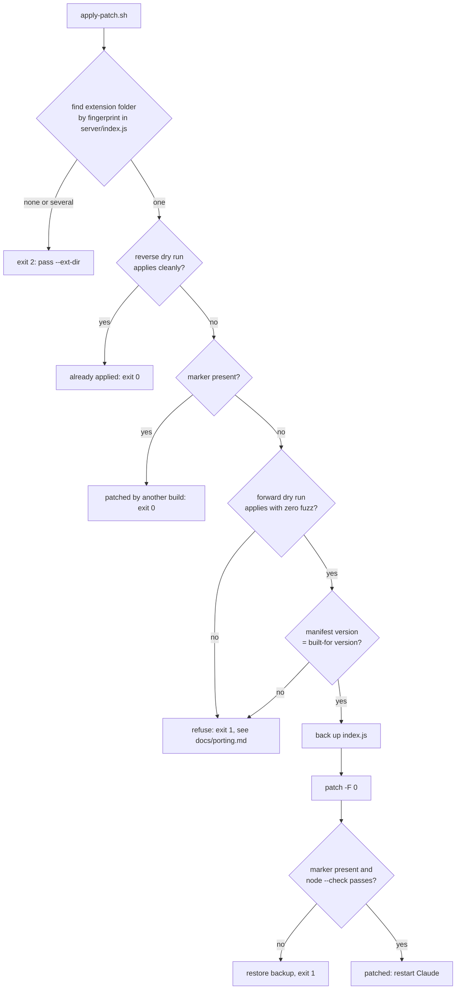

# mac-mcp-patches

[](https://github.com/gkmr/mac-mcp-patches/actions/workflows/tests.yml)   [](LICENSE)

Unofficial patches that stop two macOS MCP servers (iMessage and Apple Notes, shipped as Claude desktop extensions) from timing out, with an apply script that refuses to touch anything it was not built for.

Not affiliated with or endorsed by Anthropic or Apple.

## The problem

I use Claude desktop with the iMessage and Apple Notes extensions every day. `search_contacts` timed out on every call against my address book (thousands of contacts), `list_notes` was slow and could return broken JSON, and nothing had a timeout, so one stuck AppleScript froze the tool. I fixed the server code, but each extension update overwrites it. So the fixes live here as small diffs plus a script that re-applies them only when it is safe.

| Patch | Bug | Fix |
|---|---|---|
| iMessage v0.1.11 | `search_contacts` makes one Apple Event per contact and times out | read the AddressBook SQLite databases directly (about 10 ms), AppleScript kept as a capped fallback |
| | `send_imessage` fails on formatted numbers and SMS-only recipients | normalize to E.164, try iMessage then SMS, 15 s cap |
| Notes v0.1.7 | `list_notes` does 4 Apple Events per note and hand-builds JSON | 4 bulk Apple Events total, JSON built in JavaScript, 45 s cap |
| | `get_note_content` needs the exact title | exact match, then contains-match (reads only) |
| both | `osascript` runs with no timeout | optional timeout with SIGKILL on every call |

Details per bug (symptom, root cause, fix, tradeoffs): [docs/imessage.md](docs/imessage.md), [docs/notes.md](docs/notes.md).

## How it works



The script never decides from a version string alone. `patch --dry-run` is the judge: run in reverse it tells "already applied", run forward with zero fuzz it tells "this is the exact upstream file". The version check sits on top, because a diff can apply cleanly to a newer file whose surrounding code changed meaning.

## Quickstart

Needs macOS, bash, `patch` (both ship with macOS) and the extension installed in Claude desktop.

```bash
git clone https://github.com/gkmr/mac-mcp-patches.git
cd mac-mcp-patches

# see what would happen, change nothing
./patches/imessage/apply-patch.sh --check
./patches/notes/apply-patch.sh --check

# apply (backs up first; safe to re-run), then quit and reopen Claude
./patches/imessage/apply-patch.sh
./patches/notes/apply-patch.sh

# undo
./patches/imessage/apply-patch.sh --revert
```

Try the guard without touching anything real. The example folders are synthetic stand-ins with the wrong version, so the script finds them and refuses:

```bash
CLAUDE_EXTENSIONS_DIR=examples/fake-extensions ./patches/notes/apply-patch.sh --check
# installed version: 0.0.0-example; patch built for: 0.1.7; state: unknown
# error: the patch does not apply cleanly to this file ...
```

Backups go to `~/.mac-mcp-patches/backups/<patch>/` (override with `MAC_MCP_PATCHES_BACKUP_DIR`). The search root is `~/Library/Application Support/Claude/Claude Extensions` (override with `CLAUDE_EXTENSIONS_DIR`, or pass `--ext-dir`).

## How it is verified

```bash
python3 -m unittest discover -s tests -v
```

16 tests, Python stdlib only, no network.

- **10 always run.** Each patch parses as a unified diff with hunk counts that match their headers, adds its marker, and never removes the fingerprint the script searches for. Both scripts pass `bash -n`. Against synthetic extension folders, the script exits 2 when nothing or two folders match, exits 1 and leaves the file byte-identical on a wrong version or wrong content (no backup written), and exits 0 on an already-patched file.
- **6 need the upstream file**, which this repo does not ship (no license is stated in its header). Supply it with `MCP_PATCHES_IMESSAGE_ORIG=/path/to/index.js` and `MCP_PATCHES_NOTES_ORIG=...`, or put it at `tests/upstream/<name>/index.js` (git-ignored). The test checks its sha256 first, then: `patch --dry-run -F 0` applies with no fuzz and no offset; a full apply, re-apply, `--check`, `--revert` cycle ends byte-identical to upstream with one backup; and the real file with a newer manifest version is refused. Without the file these 6 report as skipped, not passed.

On my machine with both upstream files supplied: 16 run, 16 pass, 0 skipped.

## Design decisions and tradeoffs

- **Ship diffs, not files.** The upstream `server/index.js` has no license header, so the repo carries only changed lines plus 3 lines of context per hunk. The cost: tests that need the real file skip on a fresh clone.
- **Dry run beats markers.** The first version grepped for a marker string and copied a whole patched file over the extension. That silently discarded upstream changes on a forced copy. Now the diff itself decides, with zero fuzz, and the marker is only a fallback signal.
- **Refuse on version mismatch even when the diff applies.** Context lines can match while the code around them changed. Porting is a deliberate manual step ([docs/porting.md](docs/porting.md)).
- **Keep the slow path as a fallback.** The SQLite contact search reads Apple's private AddressBook schema, which can change in any macOS update. The AppleScript path stays, now filtered inside Contacts and capped.
- **No process killing.** The private iMessage script killed the Claude helper process to reload the server. That depends on internal process names, so the script now just tells you to restart Claude.
- **Contains-match only for reads.** `get_note_content` falls back to a contains-match; `update_note_content` stays exact so a fuzzy match can never overwrite the wrong note.

## Limitations

- macOS only, and pinned to iMessage extension 0.1.11 and Notes extension 0.1.7. Every extension update needs a re-port.
- The SMS fallback needs Text Message Forwarding from an iPhone.
- The SQLite path needs Full Disk Access for the process running the server (the iMessage extension already needs it for `chat.db`).
- The contains-match returns the first matching note when several titles contain the text.
- Tested on the patch logic and the guards. The patched servers themselves were checked by hand on my Mac, not by an automated test here.

## Layout

```
mac-mcp-patches/
├── patches/
│   ├── imessage/
│   │   ├── apply-patch.sh
│   │   └── imessage-v0.1.11-fast-search-sms-fallback.patch
│   └── notes/
│       ├── apply-patch.sh
│       └── notes-v0.1.7-bulk-list-timeouts.patch
├── lib/apply-common.sh        shared find / check / backup / apply / revert logic
├── docs/
│   ├── imessage.md            bugs, root causes, fixes, tradeoffs
│   ├── notes.md
│   └── porting.md             moving a patch to a new extension version
├── examples/fake-extensions/  synthetic extension folders the script refuses
├── tests/test_patches.py
├── CHANGELOG.md
└── LICENSE
```
